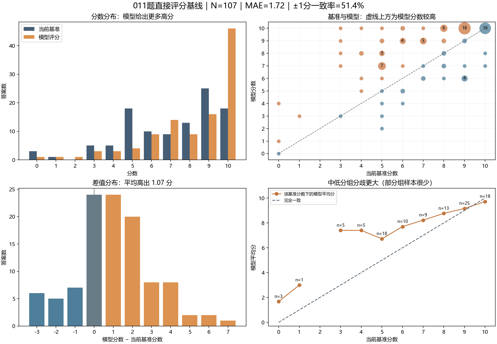

# 011题普通大模型直接评分：对比分析报告

分析日期：2026年11月8日。模型名称按用户实验记录为 **DeepSeek-V4.1-Flash-1017**，运行于 **CodeArts Agent**；未使用本团队设计的教师校准Agent。

## 1. 主要结论

本次107份答案全部成功对齐。相对当前基准，模型平均高出 **1.07分**，平均绝对误差 **1.72分**；完全同分率 **22.4%**，误差不超过1分的比例 **51.4%**。差异主要集中在中低分答案，模型倾向给出更高分，满分数量由基准的18份增加到46份。

**这证明当前评分口径尚未对齐。** 部分最大分差恰好涉及可行的替代算法，原低分值得进一步复核；同时也发现模型理由与原文矛盾、漏检代码分支错误等可直接检查的问题。



## 2. 实验设置与数据可信度

- 输入：题目、参考答案、满分10分，以及107条无分答案。已逐条核对测试目录的输入与当前数据包一致，字段仅为answer_id、q_id、answer，没有score。
- 用户提供的提示词没有带分样例和显式得分细则，适合作为“参考答案直接评分”的第一条基线。代码或文件读取由CodeArts Agent完成，不能当作已经测量过的无工具裸模型API调用。
- 一次评分结果；是否内部拆批、模型调用次数、温度、耗时、成本及完整代理上下文未提供。本报告不据此评价速度、成本或多次运行稳定性。
- 对齐结果：107个唯一编号，无缺失、重复、额外编号；107条分数均为0—10整数，理由均非空，均未超过100个字符。
- 当前基准：7条teacher_reviewed、100条尚未重新核分的原标签。已复核7条只有2种去空白后的不同文本，不能把它们当成7个独立、丰富的教师标准案例。

**实际提示词：**

```text
你是一名数据结构课程阅卷教师。请根据题目、参考答案(参见文件夹里的"01_题目与参考答案.md"),对"04_全部答案_无得分.jsonl"里面的每个答案给出你的评分,仅返回以下JSON：
{
  "answer_id": "答案编号",
  "score": 0,
  "reason": "简要说明得分依据、遗漏或错误，不超过100字"
}
```

## 3. 总体分数一致性

| 指标 | 实测 | 含义 |
| --- | ---: | --- |
| 平均基准分 / 模型分 | 7.08 / 8.15 | 模型整体偏高 |
| MAE | 1.720 | 每份答案平均相差多少分，越低越好 |
| RMSE | 2.280 | 对较大的分差赋予更高权重 |
| 平均有符号差 | +1.065 | 模型分−基准分 |
| 完全同分 | 24/107，22.4% | 不是经教师重新裁定的正确率 |
| 误差≤1分 | 55/107，51.4% | 容差内一致率 |
| 误差≤2分 | 80/107，74.8% | 容差内一致率 |
| 绝对差≥3分 | 27/107，25.2% | 本报告探索性定义的较大分差 |
| 绝对差≥4分 | 13/107，12.1% | 优先人工检查 |
| 模型高于 / 低于基准 | 65 / 18条 | 另外24条相同 |
| 最大差值 | +7 / -3分 | 最大正差不代表已证实错给分 |
| Pearson / Spearman | 0.646 / 0.618 | 有一定线性及排序关联，但不代表同分 |
| 二次加权Kappa | 0.585 | 0—10共11档，较大分差惩罚更重 |
| 按基准分档平均的MAE | 2.096 | 每个出现的基准分档等权，减少高分样本多的影响 |

按98个去空白同文组做4,000次组级bootstrap，MAE的95%区间约为 **[1.42, 2.03]**，平均有符号差约 **[0.68, 1.46]**。这只反映该批样本的抽样不确定性，不覆盖标签错误、换题泛化或模型多次运行波动。

作为简单参照，若107份全给10分，MAE为2.92；当前模型的1.72更低，说明它确实在区分答案，不能仅因一致率低就说完全没有评分能力。该常数参照也不是对完整Agent的效果比较。

## 4. 不同基准分档表现

| 基准分 | 数量 | 模型平均分 | MAE | 平均差值 |
| ---: | ---: | ---: | ---: | ---: |
| 0 | 3 | 1.67 | 1.67 | +1.67 |
| 1 | 1 | 3.00 | 2.00 | +2.00 |
| 3 | 5 | 7.40 | 4.40 | +4.40 |
| 4 | 5 | 7.40 | 3.40 | +3.40 |
| 5 | 18 | 6.72 | 2.39 | +1.72 |
| 6 | 10 | 7.70 | 2.50 | +1.70 |
| 7 | 9 | 8.22 | 1.67 | +1.22 |
| 8 | 13 | 8.77 | 1.38 | +0.77 |
| 9 | 25 | 9.16 | 1.28 | +0.16 |
| 10 | 18 | 9.72 | 0.28 | -0.28 |

原3分与4分组的模型平均分都为7.4，差异尤其突出；两组都只有5条，不宜把该均值当作稳定的普遍规律。原10分组平均模型分9.72、MAE0.28，模型对高分答案与当前基准更接近。

## 5. 分数阈值与满分判断

下表用6、9、10分作探索性阈值；6分仅是假设的业务界线，并非教师已经确定的验收标准。“误判”在此仅指相对当前基准的阈值不一致。

| 阈值 | 基准未达标→模型达标 | 基准达标→模型未达标 | 阈值一致率 |
| --- | ---: | ---: | ---: |
| ≥6分 | 22 | 3 | 76.6% |
| ≥9分 | 26 | 7 | 69.2% |
| ≥10分 | 30 | 2 | 70.1% |

模型给46份满分，其中16份基准也为10分、30份基准低于10分；基准18份满分中另有2份被模型打成更低分。因此模型满分判定与基准匹配16/46=34.8%。不能把其余30份全部宣判为错给满分，需结合后面的替代解法和标签复核。

若暂按6分界线，基准低于6分的32份中，有22份被模型给到6分以上，占68.8%；这是部署前值得关注的口径差异，但仍需先确认这32份的人工标准可靠。

## 6. 已复核样本、重复文本和原学习子集

| 子集 | N | MAE | 平均差值 | 完全同分率 |
| --- | ---: | ---: | ---: | ---: |
| 本轮教师已复核 | 7 | 1.00 | +1.00 | 0.0% |
| 未重新核分的原标签 | 100 | 1.77 | +1.07 | 24.0% |
| 去空白文本去重后 | 98 | 1.81 | +1.09 | 21.4% |
| 原10%学习子集 | 11 | 1.64 | +1.64 | 27.3% |
| 其余答案 | 96 | 1.73 | +1.00 | 21.9% |

- 已复核7条均为教师9分、模型10分，表现为明确的1分口径差。它们仅有2种文本，不能据此声称教师独立验证了一整套评分能力。
- 共有5个重复组、涉及14条答案，模型在这5组内均给出一致分数；这是同一批内的一致性，不能证明跨次运行稳定。去重后仍有98种文本，可减轻重复答案权重。
- 此处的“原学习子集”只是历史数据划分标记。当前提示词没有提供带分学习样例，因此这两行不表示本次已经训练/校准过，也不能作训练集与测试集效果解释。全量评分后已分析的这批数据应记为开发评测资料。

## 7. 答案长度与输出可核查性

| 原答案字符数 | N | MAE | 平均差值 |
| --- | ---: | ---: | ---: |
| 0—100字 | 25 | 1.96 | +1.00 |
| 101—300字 | 58 | 1.83 | +1.10 |
| 301字以上 | 24 | 1.21 | +1.04 |

字符数不等于token数。各组题解类型和原分构成不同，本表只能描述现象，不能据此认定模型偏好长答案。

107条均有理由，便于初步检查；但输出只有总分和短理由，没有逐项配分、学生原文引文、固定规则版本、不确定标记，因此无法直接算逐得分点正确率、引文支持率或风险分流质量。不能把“理由非空”当作理由可靠。

## 8. 理由与算法正确性：关键案例

| 答案编号 | 当前基准 / 模型 | 初步解释 |
| --- | ---: | --- |
| 011-000037 | 3 / 10 | 原标签值得复核，不能直接认定模型多给7分 |
| 011-000020 | 3 / 9 | 原标签值得复核，不能直接认定模型多给6分 |
| 011-000057 | 6 / 10 | 替代方案有效，原6分需解释 |
| 011-000038 | 5 / 8 | 模型理由与学生原文直接矛盾 |
| 011-000077 | 5 / 9 | 模型漏掉真实代码分支错误 |
| 011-000002 | 6 / 9 | 替代算法认可与扣分理由存在冲突 |
| 011-000059 | 9 / 6 | 对笔误的容忍口径不同 |
| 011-000089 | 5 / 7 | 模型确实识别到代码不可达问题 |
| 011-000058 | 4 / 10 | 模型可能补全了没有明确写出的操作 |
| 011-000019 | 5 / 10 | 入队分支有遗漏，模型给满分需要复核 |

完整学生原文、模型理由和人工初步分析见[差异案例复核清单](011_差异案例复核清单.md)。

为复核020与037/057的替代算法，程序按照文字含义自行重建了两种栈操作方案，各检查1—10步的全部合法入队/出队序列，共各525条，输出与FIFO队列一致。这不是执行学生原代码，也不能替代教师对措辞、空队列保护和效率要求的裁定；它支持“替代方案本身可行”的判断。

**当前至少有两种方向的问题同时存在：** 模型会误读明确写出的内容或漏掉分支错误；数据集原标签也可能对正确替代算法给了偏低分。大分差应先进入复核，而不是直接计作模型错误。

## 9. 对我们Agent设计与下一轮实验的启示

1. **先补可靠评测标准。** 优先请教师盲看037、020、057、058、077、038等案例，不预先展示模型分数；确认替代算法是否接受、是否考查效率、笔误及省略语怎样扣分，再冻结测试标签。不要为了让本项目赢而按模型分差选择有利标准。
2. **从缺失口径提炼可检查规则。** 规则至少区分原参考的双持久栈方案与每次还原到单栈的方案，分别判断判空条件；不要要求所有解法都写“两栈均空”。明确正确文字与错误代码冲突时怎么给分。
3. **真正校准后再比较。** 使用同一底层模型、相同题目和最终测试：比较①当前参考答案直接评分；②同样少量带分样例的直接评分；③规则提炼＋教师确认＋案例检索＋疑难复核的Agent。②不可省略，否则样例带来的提升会被算成Agent架构贡献。
4. **做针对性的代码和证据检查。** 例如S2空、S1仅一个元素时是否能出队；每次出队后是否还原到同一栈；理由里提到“没写”的内容是否真的缺失。对不能确定的替代算法转人工，不把模板差异直接判错。
5. **另外测稳定性和人工负担。** 固定模型版本与参数，重复并打乱答案顺序，比较分数波动；记录教师准备规则、校准、复核、返工的总时间，以及调用数、延迟和成本。本轮没有这些数据，暂不能宣称效率提升。

**当前结论：** 普通大模型已具备一定的题意理解、错因定位和替代算法识别能力，但与当前基准存在偏高及配分差异，理由可靠性也有具体缺陷；本轮尚不能证明我们未运行的Agent优于它。项目应验证教师校准与复核是否在可靠标签上改善一致性、证据质量和人工总成本。

## 10. 文件与复现

- [原始模型结果](011_模型批改原始结果.json)：用户粘贴结果原样保存。
- [逐条评分对照](011_逐条评分对照.jsonl)：107条，含基准、原数据分、教师复核状态、模型分、差值、原文与理由。
- [统计结果](011_统计结果.json)、[实验配置与提示词](011_实验配置.json)。
- [混淆矩阵](011_评分混淆矩阵.png)。输入、题目与基准快照保存在`评测输入快照`；脚本为测试目录下`分析011评分结果.py`。
- 后续独立评分使用干净目录，只交给待测模型题目、参考答案和无分输入，避免其读取本分析目录中的基准分及结果。
