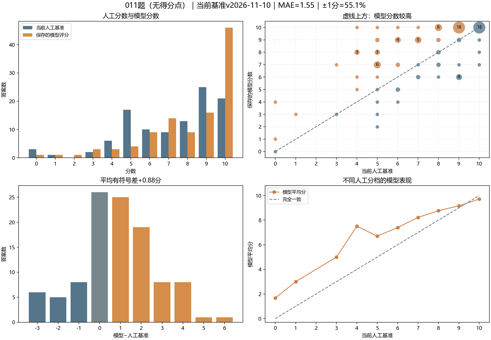

# 011题：无得分点模型评分与当前人工基准

重算日期：2026年11月10日。基准版本：2026-11-10-user-approved-v1。模型名称按用户实验记录为DeepSeek-V4.1-Flash-1017，运行于CodeArts Agent。

**本报告使用原先保存的107条模型输出，仅按新人工基准重新计算，不是重新运行模型。** 当前基准包括7条既有教师审核、5条用户确认修订、95条未在本项目重新核分的原标签。用户确认未冒称教师新增签字。

## 1. 主要结论

人工平均分7.27，模型平均分8.15；模型平均高出0.88分。MAE为1.55，完全同分率24.3%，误差≤1分的比例55.1%。这些是一致性指标，不能视为全部标签经教师重新裁定后的真实正确率。

本次标签已按用户确认接受020、037、057的正确替代解法，并修订046、069。原来的“这些标签待定”判断已被当前确认版替代。该批案例参与了规则与标签调整，应继续视为开发/校准数据。

## 2. 数据与实验口径

- 107个唯一答案编号全部对齐；无分输入未携带分数，答案文本与当前有分版一致，均未因本次改分而变化。
- 模型原始结果、实验当时输入的题目快照保留原样。当前题目MD可能包含后续规则更新，不能倒称模型运行时看过这些新规则。
- 评测输入快照中的人工基准文件已同步当前确认版；标签版本、SHA-256及复算时间写入实验配置。
- 仅一次保存的模型结果；未测多次运行稳定性，未新增模型调用或费用。

## 3. 整体一致性

| 指标 | 实测 |
| --- | ---: |
| 平均绝对误差MAE | 1.551 |
| RMSE | 2.037 |
| 平均有符号差 | +0.879 |
| 完全同分 | 26/107，24.3% |
| 误差≤1分 | 59/107，55.1% |
| 误差≤2分 | 83/107，77.6% |
| 绝对差≥3分 / ≥4分 | 24 / 10条 |
| 高于 / 低于人工基准 | 62 / 19条 |
| 最大正差 / 最大负差 | +6 / -3 |
| Pearson / Spearman | 0.700 / 0.661 |
| 二次加权Kappa | 0.653 |

## 4. 各人工分档

| 人工分 | N | 模型平均分 | MAE | 平均差值 |
| ---: | ---: | ---: | ---: | ---: |
| 0 | 3 | 1.67 | 1.67 | +1.67 |
| 1 | 1 | 3.00 | 2.00 | +2.00 |
| 3 | 2 | 5.00 | 2.00 | +2.00 |
| 4 | 6 | 7.50 | 3.50 | +3.50 |
| 5 | 17 | 6.71 | 2.41 | +1.71 |
| 6 | 10 | 7.40 | 2.20 | +1.40 |
| 7 | 9 | 8.22 | 1.67 | +1.22 |
| 8 | 13 | 8.77 | 1.38 | +0.77 |
| 9 | 25 | 9.16 | 1.28 | +0.16 |
| 10 | 21 | 9.71 | 0.29 | -0.29 |

各档样本量不相等，低分档部分仅有少量样本。分档均值不能直接证明模型对某类答案普遍有效或无效。

## 5. 标签来源与重复文本

| 子集 | N | MAE | 完全同分率 |
| --- | ---: | ---: | ---: |
| 未在本项目重新审核的原标签 | 95 | 1.61 | 25.3% |
| 既有教师审核 | 7 | 1.00 | 0.0% |
| 本次用户确认修订 | 5 | 1.20 | 40.0% |
| 去空白文本去重后 | 98 | 1.62 | 23.5% |

7条教师案例只有两种文本；已知规则和同文样本不等于多个独立测试。用户确认的5条也参与了开发讨论，不能拿该子集单独证明模型泛化。

## 6. 阈值一致性

6、9、10分为探索性界线，不代表已确认的业务验收阈值。

| 阈值 | 人工未达→模型达到 | 人工达到→模型未达 | 一致率 |
| --- | ---: | ---: | ---: |
| ≥6 | 19 | 3 | 79.4% |
| ≥9 | 23 | 7 | 72.0% |
| ≥10 | 28 | 3 | 71.0% |

当前人工满分21条，模型满分46条，其中同时满分18条。其他不一致要结合评分依据核查，不仅凭标签差异断定模型错误。

## 7. 已确认案例与剩余问题

| 答案编号 | 当前人工分 | 保存的模型分 | 当前结论 |
| --- | ---: | ---: | --- |
| 011-000046 | 4 | 8 | 用户确认4分；保留局部正确分，不补出完整倒栈和继续出队分支。 |
| 011-000069 | 6 | 7 | 用户确认6分；不能借用入队循环给出队搬移分，概念分可单计。 |
| 011-000020 | 10 | 9 | 用户确认10分；出队后还原S1，单栈判空成立。 |
| 011-000037 | 10 | 10 | 用户确认10分；S2存队列，S1临时辅助，符合FIFO。 |
| 011-000057 | 10 | 10 | 用户确认10分；新元素置底后还原旧元素，符合FIFO。 |
| 011-000038 | 5 | 8 | 原文明确两栈均空，理由必须与原文一致；原标签仍待进一步审核。 |
| 011-000077 | 5 | 9 | 存在代码条件反向；是否识别应直接对照原文，文字与代码配分仍需统一。 |
| 011-000101 | 8 | 7 | 等待S2清空的约束是否支持任意交错操作，仍需复核。 |

逐条原文及保存的模型理由见[差异案例复核清单](011_差异案例复核清单.md)。尚未输出完整逐项分值与原文依据，不能仅因总分有理由就认定过程完全可追溯。

## 8. 运行记录与后续使用

原实验未记录同口径耗时与积分，本次不补造数据。

模型输出没有重跑，指标变化来自人工标签修订。以后评估时必须记录固定标签版本；正式测试另留未参与规则或标签调整的答案。

## 9. 文件

- [统计结果](011_统计结果.json)、[实验配置](011_实验配置.json)、[逐条对照](011_逐条评分对照.jsonl)。
- [保存的模型原始结果](011_模型批改原始结果.json)。
- 题目与无分输入的历史记录保留在评测输入快照；人工基准已更新到本报告版本。
