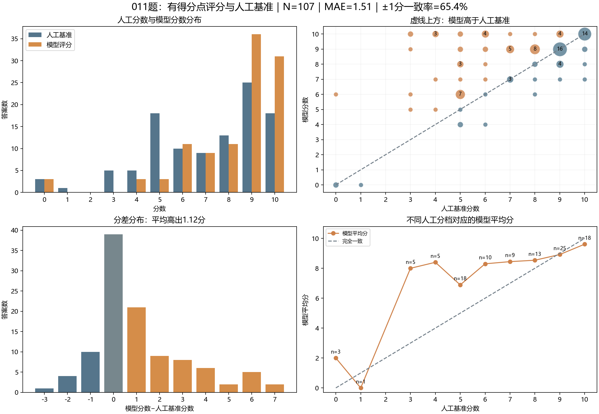

# 011题：有得分点的大模型评分与人工分数比较

分析日期：2026年11月8日。模型按用户记录为DeepSeek-V4.1-Flash-1017，运行于CodeArts Agent。本报告仅分析本次提供得分点的评分结果。

## 1. 比较口径与结论

**本报告的“原始分数/人工基准”指整理包当前有分JSONL中的人工分数。

107条模型结果完整对齐。模型平均分8.21，人工基准平均分7.08；平均高出1.12分。平均绝对误差为1.51分，完全同分率36.4%，误差≤1分的一致率65.4%。模型对中低分答案给分更宽，对高分答案更贴近人工标签。

部分大分差来自可行替代算法与原标签之间的争议；另有省略步骤、文字代码冲突及理由不足以还原总分的问题。因此完全同分率不是已经过教师重新裁定的真实正确率，不能把全部分差直接算成模型错判。

## 2. 数据与输出检查

- 107个唯一答案编号，无缺失、重复或额外编号；输入只含answer_id、q_id、answer，未含分数，并与人工基准的答案文本逐条一致。
- 107条模型分数均为0—10整数，理由均非空且不超过100个字符。题目MD含满分、参考答案、五个得分点与判定说明。
- 只有一次评分结果；未获得完整实际提示词、温度、内部拆批、调用日志，不能评价多次运行稳定性。

## 3. 整体分数一致性

| 指标 | 实测结果 |
| --- | ---: |
| 人工均分 / 模型均分 | 7.08 / 8.21 |
| 平均绝对误差MAE | 1.514分 |
| 均方根误差RMSE | 2.344分 |
| 平均有符号差 | +1.121分 |
| 完全同分 | 39/107，36.4% |
| 误差≤1分 | 70/107，65.4% |
| 误差≤2分 | 83/107，77.6% |
| 绝对差≥3分 | 24/107 |
| 绝对差≥4分 | 15/107 |
| 高于 / 低于人工基准 | 53 / 15条 |
| 最大正差 / 最大负差 | +7 / -3分 |
| Pearson / Spearman | 0.611 / 0.469 |
| 二次加权Kappa | 0.539 |

按98种去空白文本进行4,000次组级bootstrap，MAE的95%区间约为[1.16, 1.91]。该区间只描述本批样本抽样不确定性，不包含标签错误与模型重复运行波动。

## 4. 各人工分档表现

| 人工分数 | N | 模型平均分 | MAE | 平均差值 |
| ---: | ---: | ---: | ---: | ---: |
| 0 | 3 | 2.00 | 2.00 | +2.00 |
| 1 | 1 | 0.00 | 1.00 | -1.00 |
| 3 | 5 | 8.00 | 5.00 | +5.00 |
| 4 | 5 | 8.40 | 4.40 | +4.40 |
| 5 | 18 | 6.89 | 2.11 | +1.89 |
| 6 | 10 | 8.30 | 2.70 | +2.30 |
| 7 | 9 | 8.44 | 1.44 | +1.44 |
| 8 | 13 | 8.54 | 1.00 | +0.54 |
| 9 | 25 | 8.92 | 0.40 | -0.08 |
| 10 | 18 | 9.61 | 0.39 | -0.39 |

原3分和4分组的模型平均分分别为8.0和8.2，分差尤其突出；但两组各仅5条，其中含有替代算法争议，不能据此直接认定模型在低分答案上全部判断错误。

## 5. 阈值与满分判断

6、9、10分只作为探索性界线，不代表已确定的业务验收标准。

| 阈值 | 人工未达→模型达到 | 人工达到→模型未达 | 阈值一致率 |
| --- | ---: | ---: | ---: |
| ≥6 | 24 | 1 | 76.6% |
| ≥9 | 31 | 7 | 64.5% |
| ≥10 | 17 | 4 | 80.4% |

人工满分18条，模型满分31条；模型满分中14条人工也满分、17条人工低于满分，另有4条人工满分被模型给了较低分。满分与人工标签匹配14/31=45.2%，但17条不一致仍需逐项复核，不能直接等同17次已确认错判。

## 6. 教师复核、重复文本与长度

| 子集 | N | MAE | 平均差值 | 完全同分率 |
| --- | ---: | ---: | ---: | ---: |
| 老师已明确复核 | 7 | 0.00 | +0.00 | 100.0% |
| 未重新核分的原标签 | 100 | 1.62 | +1.20 | 32.0% |
| 同文去重后 | 98 | 1.63 | +1.20 | 31.6% |

老师已复核7条均为9分，模型也给9分，但仅对应两种文本；输入细则已经注明这两类表述为9分，因此该结果反映已知规则遵从，不构成未见答案的独立验证。5个重复文本组内模型分数均一致，只说明本次任务内的一致性。

| 答案字符数 | N | MAE | 平均差值 |
| --- | ---: | ---: | ---: |
| 0—100字 | 25 | 1.76 | +1.36 |
| 101—300字 | 58 | 1.59 | +1.14 |
| 301字以上 | 24 | 1.08 | +0.83 |

字符数不等于token数。不同长度组的题解与人工分数构成不同，本表不能用于因果判断模型偏好长答案。

## 7. 理由可靠性与重点案例

| 答案编号 | 人工基准 | 模型 | 需要核查的方面 |
| --- | ---: | ---: | --- |
| 011-000002 | 6 | 10 | 全部数据在每次出队后还原到S1，因此只判S1为空可以成立。 |
| 011-000020 | 3 | 10 | 先把S1栈底以上元素移到S2，弹出栈底，再还原S1，可实现FIFO。 |
| 011-000025 | 4 | 10 | 文字中“将S2出栈压入S1”是否指全部转移不清楚；该方案也可能依靠数据始终存于单侧的不变量成立。 |
| 011-000037 | 3 | 10 | 入队时把S2倒到S1、加入新元素再倒回，保证队首在S2栈顶；S1只临时使用，判S2为空成立。 |
| 011-000038 | 5 | 9 | 学生明确写了两栈均空，模型正确识别判空，并因未明写S2非空分支给9分。 |
| 011-000057 | 6 | 10 | 把新元素放到S2旧元素之下，再倒回旧元素，可保持队首在栈顶。 |
| 011-000058 | 4 | 10 | 原文有出队的空/非空分支，但“从S1出栈，再入S2，再出栈”没有明确全部转移。 |
| 011-000059 | 9 | 8 | 学生写“把S1中的元素全部压入S1”，且未写倒栈后弹出。 |
| 011-000062 | 0 | 6 | 开头双栈概述基本正确，但正文三问用循环队列front/rear作答。 |
| 011-000077 | 5 | 8 | 模型正确指出代码else-if反向：S2空且S1非空会报队列空，两栈均空又可能执行Pop。 |
| 011-000101 | 8 | 10 | 原文要求等S2全部出栈后才能再转入新元素，可能只说明分批处理，而未实现任意交错的入队出队。 |
| 011-000102 | 9 | 8 | 原文描述了S2非空出队及两栈空报错，但缺少S1非空、S2空时的倒栈分支；模型识别该缺失。 |
| 011-000030 | 8 | 8 | 模型理由只写倒栈条件扣1分，却给8分；没有逐项得分，无法重建其他扣分。 |
| 011-000033 | 9 | 8 | 模型指出倒栈条件反向，这与原文相符。 |

完整原文、理由和初步分析见[差异案例复核清单](011_差异案例复核清单.md)。模型已能识别一些真实代码缺陷和替代解法，但仍需核查：是否替学生补全了未写操作、是否检查任意交错操作、是否把正确概述与错误代码区分给分。

输出只有总分和短理由，没有逐项分值或原文引用，因此不能完整检验分项合计、逐点准确率与证据支持率。理由说“扣1分/扣2分”但没有列其余项时，只能说可追溯信息不足，不能直接断言算术错误。

## 8. 时间、积分与实验限制

- 界面显示完成时间4分57秒，即297秒；预估积分10.67。积分是预估值，不是实际账单金额；完成时间也不等于已核验的纯模型推理时间。
- 模型分数可用于评分建议，但目前的人工基准尚未全部复核，细则也引用了同批案例。该批数据属于开发评测资料，不能直接用来声称未见测试的泛化效果。
- 建议先请教师确认替代算法、概述与代码冲突、笔误和省略步骤的处理，再冻结独立测试标签。需要另外记录教师准备、复核、返工总工时，才能评估实际使用价值。

## 9. 数据文件

- [模型原始结果](011_模型批改原始结果.json)、[原始粘贴](模型原始粘贴.txt)。
- [逐条评分对照](011_逐条评分对照.jsonl)：107条，含学生原文、人工分、模型分、分差、理由与基准审核状态。
- [统计结果](011_统计结果.json)、[实验配置](011_实验配置.json)。
- 本次题目、无分答案与人工基准文件保存在`评测输入快照`。输入答案与人工分数均未修改。
