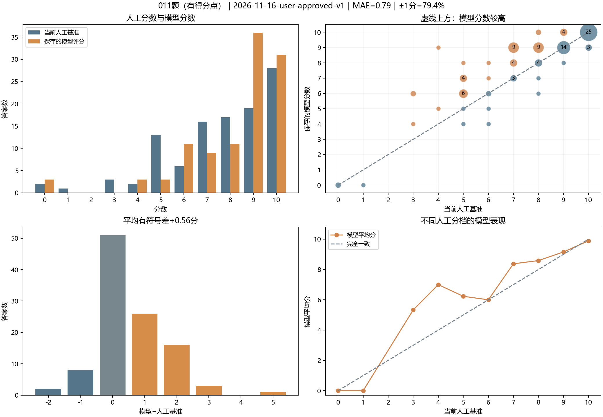

# 011题：有得分点模型评分与当前组内确认基准

重算日期：2026-11-16；标签集：`2026-11-16-user-approved-v1`。

**本报告复用原先保存的107条模型输出，更新参考标签后重新计算，没有新模型调用。**

本题107条中，48条经过本轮用户确认审阅，59条仍沿用未重新核分的原标签。另有7条保留历史教师总分记录；这些统计可能重叠，不能相加充作样本数。没有把用户确认冒称新增教师签字。

## 整体一致性

| 指标 | 当前值 |
| --- | ---: |
| 平均绝对误差MAE | 0.785047 |
| RMSE | 1.215169 |
| 平均有符号差 | +0.560748 |
| 完全同分 | 51/107 |
| 误差≤1分 | 85/107，79.4% |
| 误差≤2分 | 103/107，96.3% |
| 绝对差≥3 / ≥4分 | 4 / 1条 |
| 高于 / 低于参考分 | 46 / 10条 |
| Pearson / Spearman | 0.883 / 0.869 |
| 二次加权Kappa | 0.852 |

这些指标是保存输出与当前组内标签的一致性。部分标签在查看模型分歧后修订，样本也已用于开发，不能据此声称模型重新运行后更准、真实教师校准收益或独立最终测试效果。

## 数据与版本

- 107个编号全部对齐，答案原文不变。
- 原始模型输出、实际运行时的题目/无分答案快照保持原样；当前规则可能比当时新，不能倒称模型看过新规则。
- 评测用参考分快照同步当前标签，标签和SHA256写入实验配置。
- 最新逐项确认与29条改分依据见[数据进一步处理](../../数据进一步处理.md)。

## 各参考分档

| 参考分 | N | 模型均分 | MAE | 平均差 |
| ---: | ---: | ---: | ---: | ---: |
| 0 | 2 | 0.00 | 0.00 | +0.00 |
| 1 | 1 | 0.00 | 1.00 | -1.00 |
| 3 | 3 | 5.33 | 2.33 | +2.33 |
| 4 | 2 | 7.00 | 3.00 | +3.00 |
| 5 | 13 | 6.23 | 1.38 | +1.23 |
| 6 | 6 | 6.00 | 1.00 | +0.00 |
| 7 | 16 | 8.38 | 1.38 | +1.38 |
| 8 | 17 | 8.59 | 0.94 | +0.59 |
| 9 | 19 | 9.16 | 0.26 | +0.16 |
| 10 | 28 | 9.89 | 0.11 | -0.11 |

## 互斥来源子集及同文去重

| 子集 | N | MAE | 完全同分率 |
| --- | ---: | ---: | ---: |
| 沿用原数据集标签 | 59 | 0.746 | 42.4% |
| 本轮用户确认审阅 | 48 | 0.833 | 54.2% |
| 去空白文本去重后 | 98 | 0.837 | 43.9% |

同文组不是多个独立测试；原学习样本和移出的历史学习样本仍应排除，当前材料均按开发用途处理。

## 探索性阈值

6、9、10分只是分档分析，不代表正式业务合格阈值。

| 阈值 | 参考未达→模型达到 | 参考达到→模型未达 | 一致率 |
| --- | ---: | ---: | ---: |
| ≥6 | 14 | 2 | 85.0% |
| ≥9 | 21 | 1 | 79.4% |
| ≥10 | 6 | 3 | 91.6% |

## 运行信息与文件

模型名称、原运行平台、耗时和费用继续以原实验记录为准，本次不新填运行事实。
统计数据：[统计结果](011_统计结果.json)、[实验配置](011_实验配置.json)、[逐条对照](011_逐条评分对照.jsonl)。
原始结果：[保存的模型输出](011_模型批改原始结果.json)。
案例：[当前分差与确认依据](011_差异案例复核清单.md)。
